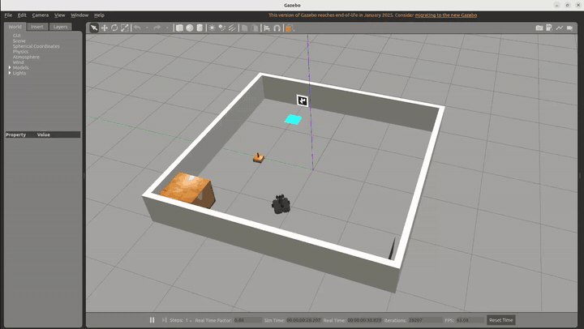
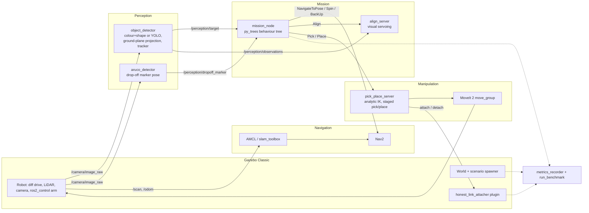
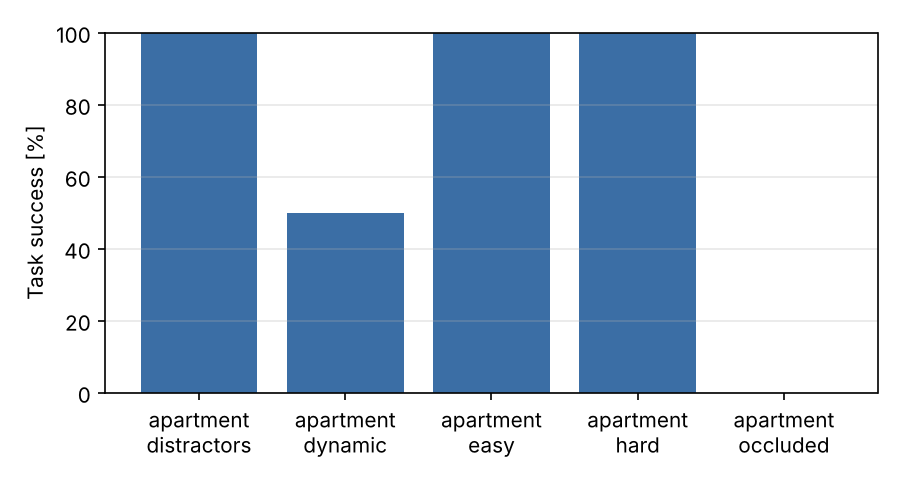
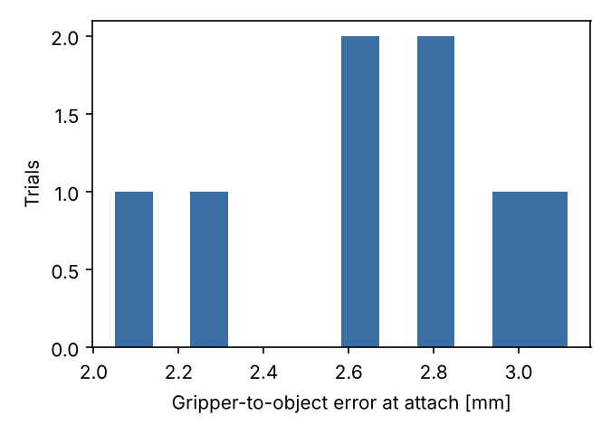

# TurtleBot3 Mobile Manipulation: Fetch & Deliver

[](docs/media/demo.mp4)

*Full mission in the arena world, 5× speed ([MP4](docs/media/demo.mp4)).*

Autonomous mobile manipulation in ROS 2 Humble and Gazebo Classic. A TurtleBot3 Waffle Pi
with an OpenMANIPULATOR-X arm searches a house or office for a target object, drives up to it,
lines up by visual servoing, and picks it up with MoveIt 2. It then finds an ArUco-marked drop-off,
places the object there, and drives home. A behaviour tree with recovery branches runs the
mission, and a benchmark harness measures every stage against Gazebo ground truth over randomized
scenarios.

| | |
|---|---|
| **Robot** | TurtleBot3 Waffle Pi + OpenMANIPULATOR-X (4-DOF arm, parallel gripper), RGB camera, 2D LiDAR |
| **Stack** | ROS 2 Humble · Gazebo Classic 11 · Nav2 · slam_toolbox · MoveIt 2 · ros2_control · py_trees · OpenCV |
| **Worlds** | Procedurally generated layouts (a small open arena by default, plus an apartment and an office) with randomized objects on tables, distractors, occlusion and moving obstacles |
| **Evaluation** | Success rate, time, grasp error, attach pass rate, placement error, detection precision/recall, localization error, collisions |

## Highlights

- **Honest grasping.** Gazebo Classic can't hold small objects with friction under position
  control (the fingers teleport into the object), so grasps use a link attacher like most Gazebo
  pick-and-place demos. Here the attacher is a custom world plugin that **refuses** to attach
  unless three physical conditions hold: the end effector is at the planned grasp pose (within
  2 cm and 0.35 rad), the gripper is actually closed, and the object is between the fingers
  (within 4.5 cm of the grasp point). Every check and its margin is logged, so a bad perception estimate produces a
  rejected grasp rather than a "magnetic" pick.
- **Full mission behaviour tree** with recoveries: re-approach when the object is lost, reject the
  object and keep searching when it turns out to be the wrong shape, clear costmaps and back up when
  a path is blocked, retry the pick, and fall back to the configured drop-off pose if the marker is
  never seen.
- **Perception that survives scrutiny.** Detections are fused in the map frame using the transform
  at image capture time (never the latest one), positions come from the blob's ground-contact edge
  (no top-face bias), and same-colour distractors are told apart by shape before the grasp.
- **Reproducible benchmark.** `run_benchmark` launches a fresh headless simulation per trial from a
  seed, records metrics against Gazebo ground truth, and writes CSV, Markdown and plots.

## Architecture



### Mission behaviour tree

```text
FetchAndDeliver (Sequence)
├── WaitForSystem                       Nav2, MoveIt, perception and TF are up
├── AcquireObject (Retry x4)
│   └── PickOrRecover (Selector)
│       ├── PickAttempt (Sequence)
│       │   ├── FindTarget: TargetKnown? | SearchForTarget (waypoints or frontiers, look-around spins)
│       │   ├── ApproachTarget          Nav2 to a collision-free standoff, re-targets as the estimate improves
│       │   ├── AlignWithTarget         visual servo to 20 cm, shape check (WRONG_OBJECT → reject track)
│       │   └── PickTarget              MoveIt: open → pre-grasp → grasp → close → honest attach → lift → stow
│       └── RecoverAndRetry             back off 15 cm, then fail so Retry runs again
├── Deliver (Sequence)
│   ├── LocateDropoff: DropoffKnown? | LookForMarker | UseConfiguredDropoff
│   ├── NavigateToDropoff               Nav2 with blocked-path recovery
│   ├── FineApproachDropoff             closed-loop base nudge to the arm's reach
│   └── PlaceAtDropoff                  lower → open → detach → retreat
└── ReturnHome
```

The live tree is published as a text snapshot on `/fetch_deliver/tree`, phases and events on
`/fetch_deliver/status` and `/fetch_deliver/events`.

## Packages

| Package | What it contains |
|---|---|
| `fetch_deliver_interfaces` | `Pick`, `Place`, `Align` actions; `AttachObject` / `DetachObject` services; observation, status and event messages |
| `fetch_deliver_description` | Robot URDF/xacro (Waffle Pi + OpenMANIPULATOR-X), configurable camera pitch, ros2_control config |
| `fetch_deliver_gazebo` | Layout definitions, world/SDF generator, scenario generator and spawner, `honest_link_attacher` plugin (C++), ground-truth map scoring |
| `fetch_deliver_moveit_config` | SRDF, kinematics, joint limits, OMPL and controller config, `move_group` launch |
| `fetch_deliver_manipulation` | Analytic IK for the 4-DOF arm, MoveIt/trajectory arm interface, pick/place action server |
| `fetch_deliver_perception` | Colour+shape detector (optional YOLO backend), multi-object tracker, ArUco drop-off detector |
| `fetch_deliver_mission` | Behaviour tree, mission node, visual-servo align server, frontier explorer |
| `fetch_deliver_bringup` | Nav2 and slam_toolbox config, saved maps, mission/mapping/navigation launch files, RViz config |
| `fetch_deliver_eval` | Metrics (clearance, detection scoring, placement), trial recorder, benchmark runner, report |

## Getting started

### Option A: native install (Ubuntu 22.04 + ROS 2 Humble)

```bash
sudo apt install python3-colcon-common-extensions python3-rosdep \
  ros-humble-gazebo-ros-pkgs ros-humble-gazebo-ros2-control ros-humble-ros2-controllers \
  ros-humble-gripper-controllers ros-humble-navigation2 ros-humble-nav2-bringup \
  ros-humble-slam-toolbox ros-humble-moveit ros-humble-py-trees ros-humble-cv-bridge \
  ros-humble-xacro

mkdir -p ~/fetch_ws/src && cd ~/fetch_ws/src
git clone https://github.com/<you>/turtlebot3-fetch-deliver.git
cd ~/fetch_ws
rosdep install --from-paths src --ignore-src -y
colcon build --symlink-install
source install/setup.bash
```

### Option B: Docker

```bash
xhost +local:docker                                   # allow GUI windows from the container
docker compose -f docker/docker-compose.yml build
docker compose -f docker/docker-compose.yml run --rm sim          # or sim-nvidia on an NVIDIA GPU
```

On laptops with hybrid graphics (for example an HP ZBook with an NVIDIA GPU), use the
`sim-nvidia` service after installing `nvidia-container-toolkit`, or run natively with
`__NV_PRIME_RENDER_OFFLOAD=1 __GLX_VENDOR_LIBRARY_NAME=nvidia` set so Gazebo renders on the GPU.

## Running

```bash
# Full mission with Gazebo and RViz
ros2 launch fetch_deliver_bringup mission.launch.py layout:=apartment gui:=true

# Harder scenario: same-colour distractors, occlusion and moving obstacles
ros2 launch fetch_deliver_bringup mission.launch.py layout:=office difficulty:=hard seed:=3 gui:=true

# Map while navigating (slam_toolbox instead of AMCL on the saved map)
ros2 launch fetch_deliver_bringup mission.launch.py slam:=true search_strategy:=frontier

# Build a new map autonomously with the frontier explorer
ros2 launch fetch_deliver_bringup mapping.launch.py layout:=office map_dir:=$PWD
```

Useful launch arguments for `mission.launch.py`:

| Argument | Default | Meaning |
|---|---|---|
| `layout` | `apartment` | `apartment` or `office` |
| `difficulty` | `easy` | `easy`, `distractors` (2–4 other objects incl. a red cylinder), `occluded` (target next to furniture), `dynamic` (moving obstacles), `hard` (all of them) |
| `seed` | `0` | scenario seed: object placement, distractors, obstacle paths |
| `target` | `red_cube` | `red_cube`, `green_cube`, `blue_cube`, `yellow_cube`, `red_cylinder` |
| `slam` | `false` | localize with AMCL on the saved map, or run slam_toolbox |
| `search_strategy` | `waypoints` | `waypoints` (layout viewpoints) or `frontier` |
| `detector` | `color` | `color` or `yolo` (needs `ultralytics` and `yolo_weights`) |
| `gui` / `rviz` | `false` / `true` | Gazebo client and RViz |

## Benchmark

```bash
ros2 run fetch_deliver_eval run_benchmark \
  --layouts apartment office --difficulties easy distractors occluded dynamic hard \
  --seeds 0-4 --out results
ros2 run fetch_deliver_eval report results          # re-generate summary.md / plots
```

Each trial records, against Gazebo ground truth:

- **Task success.** The target object was picked (not a distractor) and ended up within 25 cm of
  the drop-off.
- **Stage outcomes.** Whether the target was found, picked and delivered, plus time to detect and
  time to complete.
- **Grasp quality.** Gripper-to-object distance at attach, end-effector tracking error, and attach
  pass rate (how many attach requests passed the honest checks).
- **Placement error.** Distance from the object's final position to the drop-off point.
- **Detection precision and recall.** Scored at 3 Hz against objects that are actually in the
  camera's field of view and line of sight.
- **Localization error.** The robot's map-frame estimate versus its true pose.
- **Collisions and recoveries.** Footprint contacts with walls, furniture and moving obstacles,
  plus the number of recoveries.

### Results

Apartment layout, 2 seeds for each of the 5 difficulty levels (10 trials), headless on a 4-core
cloud machine without a GPU (the simulator ran at about 0.75× real time). Full per-trial data is in
[`docs/results/summary.csv`](docs/results/summary.csv). The office layout passed its easy and
hard scenarios in development runs but is not part of this table yet.

| Layout | Difficulty | Trials | Success | Found | Picked | Delivered | Mean time (s) | Attach pass | Grasp err (mm) | Place err (cm) | Det. P / R | Loc. err (cm) | Collisions/trial |
|---|---|---|---|---|---|---|---|---|---|---|---|---|---|
| apartment | distractors | 2 | 100% | 100% | 100% | 100% | 557.9 | 100% | 2.8 | 15.8 | 40% / 69% | 6.9 | 0.500 |
| apartment | dynamic | 2 | 50% | 100% | 100% | 50% | 899.5 | 100% | 2.6 | 126.7 | 23% / 73% | 7.3 | 0.500 |
| apartment | easy | 2 | 100% | 100% | 100% | 100% | 340.0 | 100% | 2.7 | 13.2 | 24% / 85% | 6.2 | 0 |
| apartment | hard | 2 | 100% | 100% | 100% | 100% | 530.9 | 100% | 2.5 | 16.2 | 30% / 63% | 6.8 | 0 |
| apartment | occluded | 2 | 0% | 100% | 0% | 0% | – | 0% | – | – | 29% / 53% | 37.6 | 0.500 |
| **all** |  | 10 | 70% | 100% | 80% | 70% | 536.7 | 89% | 2.6 | 43.0 | 31% / 68% | 13.0 | 0.300 |

<p>
  
  
</p>

The headline numbers:

- **70% end-to-end task success** (7 of 10), with 100% success on the easy, distractor and hard
  scenarios.
- **Grasp error 2.6 mm on average** (2.1–3.1 mm) at the moment of attach.
- **No wrong-object picks**, even with same-coloured distractors in the scene.
- **Placement error 9 cm median** on successful deliveries.

How to read the failures and the weaker numbers:

- **Occluded (0/2).** Both targets sat about 30 cm from the bed. In one trial the honest attacher
  **rejected** a grasp whose object was 7.8 cm from the gripper, so the failure was reported
  rather than faked. Localization also drifted badly in that trial (up to 2 m). Neither trial found
  a reachable approach side afterwards. Approach planning near furniture is the main open problem.
- **Dynamic (1/2).** The failed trial delivered the cube, but a moving obstacle crossed the
  drop-off afterwards and pushed it 2.5 m away. That trial also inflates the mean placement error.
- **Detection precision** is a strict per-frame score: a detection only counts if it is within
  25 cm of a visible object. Far detections (2.5–4 m) and the cube while it is held count as false
  positives, so the score understates mission-level perception. The target was found in 10 of 10
  trials.


## Design notes

**Why a link attacher, and why "honest".** Simulated friction grasps on 3 cm wide objects with
position-controlled fingers are unstable in ODE. The fingers penetrate the object and it gets
launched or slips out. Attaching a fixed joint is the standard workaround, but naive attachers
let the arm "pick" an object it never reached. `honest_link_attacher` makes the attach a
measurement: it only succeeds if the controller really put the gripper around the object.

**Analytic IK for a 4-DOF arm.** The OpenMANIPULATOR-X can't reach arbitrary 6-DOF poses, so
generic IK often fails for top-down grasps. `kinematics.py` solves the planar 3-link chain in
closed form, searching the approach pitch from 85° downwards. MoveIt then plans joint-space goals
with collision checking.

**Map-frame fusion at capture time.** An early run placed a cube 1 m from its true position. The
detector looked up the transform at image time, but when that lookup failed it fell back to the
*latest* transform, which lags by more than a second while the robot spins. The fallback is gone:
a frame without a transform at its capture time is dropped.

**Camera pitch vs. marker visibility.** The camera is 10 cm above the floor. With 23° of downward
pitch, nothing higher than about 13 cm is in view from 1.3 m. The camera is now pitched 17°
(`camera_pitch` argument) and the drop-off marker sits low on the wall.

**Mapping a long corridor.** slam_toolbox compressed the office's 10 m corridor until it was told
to trust the (accurate) simulated odometry more and to be stricter about loop closures.

**Own look-around instead of Nav2 Spin.** Nav2's Spin and BackUp check collisions using the
transform at the published footprint's timestamp. When the simulator runs below real time, that
timestamp is slightly ahead of odometry, so most spins aborted immediately and the robot never
looked around. Both are now closed-loop `cmd_vel` motions guarded by a LiDAR clearance check.

**Moving obstacles must not push the robot.** The obstacles are kinematic, so they used to shove
the robot without its wheel odometry noticing, and AMCL lost track. They now wait while the robot
is in their path, like a pedestrian would.

**Simulation cost.** ros2_control ran at 1000 Hz, which flooded `/joint_states` and `/tf` and
starved every Python TF listener. Dropping it to 100 Hz, plus throttling ArUco detection, raised
the real-time factor from 0.42 to 0.75 on 4 cores.

## Known limitations and next steps

- Approaching objects that sit close to furniture (the "occluded" scenarios) is unreliable. The
  standoff search should score the free space around each side instead of taking the first
  feasible one.
- Moving obstacles can cross the drop-off and knock delivered objects away. The scenario generator
  should keep their paths clear of it.
- The office layout still needs a full benchmark run (`--layouts office`).
- Grasping uses the honest link attacher. Friction-based grasping would need a physics engine
  that handles small objects better (Gazebo Sim / DART) or force-controlled fingers.

## Repository layout

```text
fetch_deliver_*/          ROS 2 packages (see table above)
docker/                   Dockerfile and compose file (GUI, optional NVIDIA)
docs/results/             benchmark summary (CSV, Markdown) and plots
.github/workflows/ci.yml  flake8, colcon build and colcon test on ROS 2 Humble
```

## License

Copyright 2026 Mustafa Almohamad. Licensed under Apache-2.0, see [LICENSE](LICENSE). Third-party parts, all Apache-2.0, are listed in
[NOTICE](NOTICE): the TurtleBot3 and OpenMANIPULATOR-X meshes, base xacros and MoveIt launch
come from ROBOTIS (see `fetch_deliver_description/LICENSE.ROBOTIS`), and the ros2_control
xacro is adapted from ros2_control_demos. Files taken from those projects say so in their
header.
